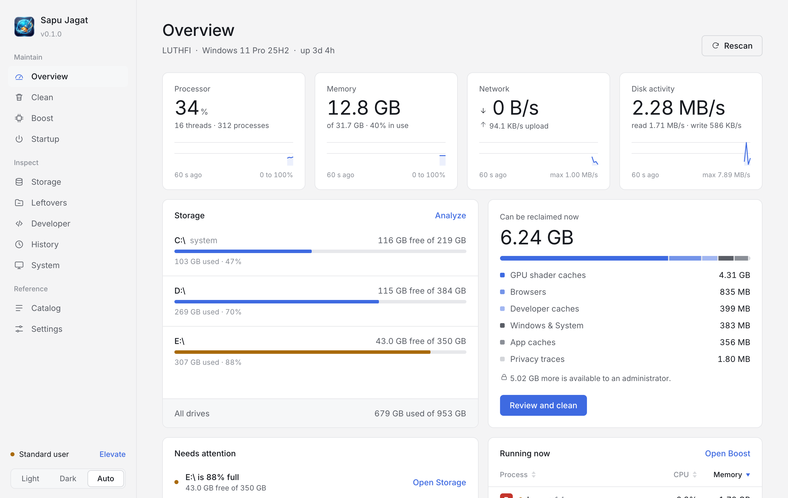

# Sapu Jagat

Deep, safe Windows cleaner, booster and disk analyzer — with a desktop app and a terminal front-end sharing one engine.

Nothing is removed before it is explained. Every rule states what it deletes, what the side effect is, and whether it needs Administrator.



## What it does

| | |
|---|---|
| **Clean** | Finds junk across Windows, browsers, GPU shader caches, developer tooling and Docker, then removes only what you approve. |
| **Boost** | Shows what is actually holding your RAM and CPU, and lets you close or trim it. |
| **Storage** | Disk analyzer that measures a folder or a whole drive and names the big items. |
| **Startup** | Lists startup entries and lets you disable them. |
| **Leftovers** | Finds folders left behind by apps you already uninstalled. |
| **Developer** | Finds stale `node_modules`, `target` and `venv` directories of projects you have not touched in a while. |

### How it decides what is safe

Every rule in the catalog carries a risk level:

- **Safe** — regenerates by itself, no visible side effect.
- **Careful** — safe for the system, but you will notice something (a re-download, a re-login, a slower first start).
- **Advanced** — changes system behaviour or removes something that is not a cache. Always opt-in, never on by default.

*Advanced* rules are never on by default. The defaults are the *Safe* rules plus a small number of clearly-labelled *Careful* ones, such as emptying the Recycle Bin. A System Restore point is created before a clean run unless you opt out.

## Install

Download the installer from the [latest release](../../releases/latest) and run it. It installs per-machine, so it asks for Administrator once.

## Usage

The desktop app is the main front-end. There is also a CLI:

```console
sapu                      # interactive menu
sapu scan                 # read-only report, changes nothing
sapu clean --dry-run      # show exactly what would be removed
sapu clean --yes          # clean the safe defaults without prompting
sapu clean --include-careful
sapu clean --only temp-user,thumb-cache
sapu rules                # every rule, with its risk and side effects
sapu analyze D:\ --top 30 # disk analyzer
sapu boost                # background processes
sapu startup --list
sapu dev --older-than 60  # stale project build dirs
```

`sapu rules` is the honest way to see the whole catalog before running anything.

## Building from source

Requires the [Rust toolchain](https://rustup.rs) on Windows.

```console
cargo test --workspace          # run the engine tests
cargo run -p sapujagat -- scan  # the CLI
cargo tauri build               # from gui/, produces the NSIS installer
```

The GUI front-end is plain HTML, CSS and JavaScript in `gui/ui`. You can preview it in any browser without building Rust at all — `gui/devtools/preview.html` loads the real UI against a mock backend. The screenshot above was taken from it.

## Layout

```
core/   the engine: scan, clean, boost, analyze. No terminal output lives here.
cli/    terminal front-end  -> sapu.exe
gui/    desktop app (Tauri) -> Sapu Jagat
  ui/        the shipped front-end
  devtools/  browser preview with a mock backend, not shipped
```

`core` is UI-agnostic on purpose: both front-ends call the same functions, so they can never disagree about what a rule does.

## Releasing

The version lives in exactly one place — `[workspace.package]` in the root `Cargo.toml`. The crates inherit it, and `gui/tauri.conf.json` deliberately omits `version` so the installer picks up the same number.

To ship a release:

1. Bump `version` in the root `Cargo.toml`.
2. Commit it.
3. Tag and push:

```console
git tag v0.2.0
git push origin main --tags
```

The tag starts the release workflow, which runs the full test suite first, refuses to continue if the tag does not match the version in `Cargo.toml`, then builds the installer and publishes it to GitHub Releases.

Pull requests into `main` run the same test suite.

## License

Not yet licensed. All rights reserved.
